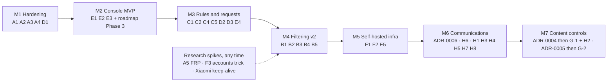

# Capability plan — adopting what the rest of the field got right

Input: [`landscape-comparison.md`](landscape-comparison.md), which verified 24
open-source projects on 2026-11-03. This plan takes the good capabilities those
projects have and Manara lacks, and turns them into ordered, buildable work.
It also lists what Manara will deliberately **not** copy.

It extends [`roadmap.md`](roadmap.md) and doesn't replace it. Phase 3 (the
controller) is still the current work. The tracks below slot in around it.

## 0. Guardrails — every item must pass all seven

These are the core of Manara. If a feature can't be built inside them, it isn't
built, however good it looks somewhere else.

| #   | Guardrail                                                                                                                                                                                                                                                                                                                                                                                                                                                                               | Source                                                                                   |
| --- | --------------------------------------------------------------------------------------------------------------------------------------------------------------------------------------------------------------------------------------------------------------------------------------------------------------------------------------------------------------------------------------------------------------------------------------------------------------------------------------- | ---------------------------------------------------------------------------------------- |
| G1  | **Visible by construction.** Nothing hidden from the child. Every new capability has a child-visible explanation, either on the managed notice or on the block screen.                                                                                                                                                                                                                                                                                                                  | ADR-0001, `legal-and-ethics.md`                                                          |
| G2  | **Collect only what a policy enables, and always say so.** Any data that leaves the device must meet five conditions: &bull; It's opt-in per policy. &bull; It's shown to the child on the managed notice and status screen while it's on. &bull; It's minimized: text before media, aggregates before raw data. &bull; It has limited retention and is encrypted at rest. &bull; The most sensitive categories, messages and calls, need their own ADR before any code. | ADR-0001 ("*what* is collected is configurable"), architecture §6, `legal-and-ethics.md` |
| G3  | **License hygiene.** Only Apache-2.0, MIT or CC0 code may be ported. Ideas from GPL/AGPL projects are reimplemented clean-room. Nothing comes from decompiled or unlicensed sources.                                                                                                                                                                                                                                                                                                    | Apache-2.0                                                                               |
| G4  | **One class per capability.** A new `PolicyEnforcer` plus one line in `EnforcerRegistry`. Decision logic stays pure and unit-tested, kept apart from the Android I/O.                                                                                                                                                                                                                                                                                                                   | architecture §2.2, CLAUDE.md                                                             |
| G5  | **Offline-first.** Enforcement runs from the cached policy. A feature that only works online is a console feature, not an enforcement feature.                                                                                                                                                                                                                                                                                                                                          | architecture §2.1                                                                        |
| G6  | **API v1 is additive only.** New policy fields get defaults that keep today's behaviour. New event kinds and endpoints are added; nothing existing changes.                                                                                                                                                                                                                                                                                                                             | architecture §5                                                                          |
| G7  | **Platform facts read from the source, done means tested on a phone.** Every `DevicePolicyManager`/`UserManager` claim below marked *verify* is checked against `developer.android.com` or AOSP before coding. Nothing ships until it has run on a real device.                                                                                                                                                                                                                         | CLAUDE.md, ADR-0003                                                                      |

## 1. What Manara won't copy, and what is deferred

**Correction to the first draft of this plan.** The first draft banned all
content collection under G2. That was stricter than the project's actual
rule. ADR-0001 forbids *hidden* monitoring; it explicitly leaves *what* is
collected configurable, and architecture §2.2 already plans call logging.
The two tables below separate capabilities that break a project rule from
capabilities the rules allow but that aren't scheduled yet.

### 1a. Rejected: breaks a project rule

| Capability                                                                                     | Seen in                                    | Why not                                                                                                   |
| ---------------------------------------------------------------------------------------------- | ------------------------------------------ | --------------------------------------------------------------------------------------------------------- |
| Hidden icon, "hide and continue"                                                               | OpenParental fork                          | G1, ADR-0001                                                                                              |
| Capture with no indicator to the child: screen mirroring with no prompt, ambient audio, camera | OpenParental fork, Headwind remote control | G1, ADR-0001. Hidden by definition                                                                        |
| Sending the child's messages to a third-party AI                                               | Kidora (OpenRouter)                        | G2/architecture §6: data leaves for a processor the family never chose. Analysis stays on the device (H5) |
| Anything derived from FlashGet's decompiled APKs                                               | OpenParental fork                          | G3                                                                                                        |
| Copying code from childscreentime                                                              | —                                          | It has no license file, so no rights are granted                                                          |
| Copying code from kid-phone-server's messenger fork                                            | kid-phone-server                           | G3 (GPL/AGPL). The *idea* is planned clean-room in Track H                                                |

### 1b. Allowed if visible, not scheduled yet

| Capability                             | Seen in                       | Status                                                                                                     |
| -------------------------------------- | ----------------------------- | ---------------------------------------------------------------------------------------------------------- |
| Disabling Incognito                    | kid-phone-server browser fork | Not needed: filtering works in Incognito. Revisit only if browsing history is ever planned                 |
| Per-URL browsing history to the parent | AdGuard query log, Fengard    | Not planned; E3 reports category counts. A future history feature would need the same treatment as Track H |
| Remote live screen view                | Headwind (paid)               | Not planned. It would need its own ADR and a persistent on-screen indicator for the whole session          |

## 2. The plan, by track

Each item gives the project it comes from, how the code can be obtained under
G3 ("port" means reuse the code directly, "clean-room" means reimplement the
idea), how it fits Manara's design, and how it will be verified.

### Track A — Hardening (closes the biggest verified gap)

**Status (2026-11-04):** A1 and A2 are built (`33bc186`) and verified on the
SM-A045F (Android 14, Device Owner).

- All five restrictions became active through a real WorkManager sync.
- Each bypass was blocked in Settings when tried by hand.
- With `DISALLOW_CONFIG_PRIVATE_DNS` active, the Device Owner could still pin
  `dns.google`, and connectivity stayed intact.
- Turning the flags off cleared every restriction Manara had set, and Private
  DNS went back to `opportunistic`.
- One `no_add_user` entry remained after that. It is a base user restriction
  ("Device policy restrictions: none"), not one Manara sets.

**A3 agent-to-API verification (2026-11-04):** Usage Access, the device
Location toggle, and Private DNS drift each produced `enforcement` events
with `missing` and `restored` statuses on the SM-A045F. Events were read
through `GET /console/devices/{deviceId}/events?kind=enforcement` after real
one-time WorkManager runs. Repeated missing Usage Access did not duplicate
the warning. DNS checks now compare both mode and hostname: automatic mode
can retain the old hostname, which previously hid the drift. All 32 unit
tests and `assembleDebug` pass. The original policy and device settings were
restored after testing, with Usage Access enabled.

This verifies health-event delivery, **not the whole parent-alert feature**.
Checks run when policy is applied; post-sync observations upload on a later
sync. Health state and its event now commit atomically in Room instead of
updating preferences before queueing. Seven storage tests pass on the same
phone: rollback on enqueue failure, concurrent deduplication, reopen,
acknowledgement, legacy-state import/reset, independent checks, and database
migration. An offline warning survived a confirmed debug-process kill and
reached the parent API once after reconnect, followed by one recovery.
An opt-in two-process test also terminates at the real event-insert boundary,
after the health-state write but before commit. The next process verified
rollback to the previous state, no queued event, and one warning on retry.
Restriction drift was also verified on the same phone: an opt-in test cleared
the previously applied Private DNS configuration restriction under policy v10.
A real worker reapplied it without a policy change; subsequent workers uploaded
exactly one `restrictions/missing` event to the parent API, with no duplicate
on healthy reapplication. This was privileged fault injection, not a demonstrated
child-accessible bypass. The original policy content is restored as v11, with
no Manara restrictions, unchanged DNS settings, enrollment, and managed notice.
Restriction events still use `collectEvents()` and do not inherit the atomic
health-state transaction guarantee. Other restriction keys/OEMs are not covered
by this drift test. All 32 unit tests and `assembleDebug` pass; the new
instrumentation APK compiles and both the drift and restoration checks pass.
Proactive parent notifications (E4) and physical power-loss testing remain open in
[`pending-verifications.md`](pending-verifications.md). A health change is
not evidence that the child deliberately bypassed a protection.

| ID  | Capability                                                                         | From                                 | Obtained by       | Manara design                                                                                                                                                                                                                                                                                                                                                | Verify                                                                                                                |
| --- | ---------------------------------------------------------------------------------- | ------------------------------------ | ----------------- | ------------------------------------------------------------------------------------------------------------------------------------------------------------------------------------------------------------------------------------------------------------------------------------------------------------------------------------------------------------ | --------------------------------------------------------------------------------------------------------------------- |
| A1  | Site-filter failures must be visible                                               | — (own defect)                       | —                 | Replace the bare `runCatching` in `SiteFilterEnforcer` with `.onFailure { Log.w }` and emit a `filter_apply_failed` event                                                                                                                                                                                                                                    | Unit test, plus an unreachable host on a real device                                                                  |
| A2  | Close bypasses: VPN config, Private DNS config, factory reset, safe boot, add user | Déchaîner (Apache), TimeLimit (idea) | port / clean-room | New `RestrictionsEnforcer` with a pure `RestrictionDecision` (desired set vs applied set gives add/clear lists). New `Policy.restrictions` field with per-restriction booleans, all defaulting to off. *Verify* each `UserManager.DISALLOW_*` constant and its Device Owner requirement                                                                      | `dumpsys user` / `dumpsys device_policy` shows the restriction set. Try each bypass by hand on a phone                |
| A3  | Bypass-evident reporting: tell the parent when a protection stops working          | OpenParental (MIT, idea)             | clean-room        | Usage Access, Location toggle, and Private DNS health transitions commit state and event together through `HealthTracker`; application failures and restriction checks still use `collectEvents()`. Reuses `enforcement` events with `enforcer`, `status`, and `detail`; health transitions use `missing`/`restored`. Parent alert delivery remains E4 work. | Three health checks and offline process-restart replay verified through the console events API; remaining gates above |
| A4  | Make the dead `callLog` field honest                                               | —                                    | —                 | Keep the field, but mark it "not yet enforced" in `openapi.yaml` and in the console, so a parent can't switch on something that does nothing. It gets implemented in H3                                                                                                                                                                                      | The spec says so; the console disables the toggle                                                                     |
| A5  | Google factory-reset protection                                                    | Déchaîner (partial)                  | research          | `setFactoryResetProtectionPolicy`. *Verify* the API level, the Google-account requirement, and how it interacts with ADR-0003's account removal. Research spike only                                                                                                                                                                                         | Spike write-up                                                                                                        |

### Track B — Filtering v2 (from "pins a DNS host" to "the child can't route around it")

| ID  | Capability                                                             | From                                                                                       | Obtained by       | Manara design                                                                                                                                                                                                                                                                                                                                                                                                                                           | Verify                                                                                                |
| --- | ---------------------------------------------------------------------- | ------------------------------------------------------------------------------------------ | ----------------- | ------------------------------------------------------------------------------------------------------------------------------------------------------------------------------------------------------------------------------------------------------------------------------------------------------------------------------------------------------------------------------------------------------------------------------------------------------- | ----------------------------------------------------------------------------------------------------- |
| B1  | On-device DNS filter that survives settings changes                    | Rethink DNS (Apache, port candidate), kid-phone-server (idea)                              | port / clean-room | New `DnsFilterEnforcer` running a local `VpnService` that answers DNS only (no traffic inspection, matching OpenParental's stance). Pinned as an always-on VPN with lockdown, so the child can't remove it (*verify* `setAlwaysOnVpnPackage(…, lockdownEnabled)` and its Device Owner semantics). The pure part, `DomainDecision` (domain → allow/block/rewrite), is unit-tested. `SiteFilterEnforcer` stays as the simple mode; the policy chooses one | Blocked domain fails in a browser and in an app. Toggling Settings → VPN or Private DNS has no effect |
| B2  | Browser policy: URL blocklist, SafeSearch, YouTube restricted, DoH off | Déchaîner (Apache)                                                                         | port              | Inside B1's enforcer or a separate `BrowserPolicyEnforcer`, using `setApplicationRestrictions` on Chrome. *Verify* the Chrome managed-config key names against Chrome Enterprise docs. **Incognito left alone** (§1)                                                                                                                                                                                                                                    | `chrome://policy` on the device shows the keys                                                        |
| B3  | SafeSearch enforced at DNS for all browsers                            | AdGuard Home, Fengard (ideas; uses Google/Bing/YouTube's documented safe-search hostnames) | clean-room        | Rewrite rules in `DomainDecision`                                                                                                                                                                                                                                                                                                                                                                                                                       | `nslookup www.google.com` through the filter returns the safe-search address                          |
| B4  | Close the browser-DoH hole                                             | kid-phone-server (admits the hole), hagezi DoH list                                        | clean-room + data | Block known DoH endpoints in B1. B2 turns DoH off in Chrome. A policy option suspends browsers Manara can't manage (Déchaîner idea)                                                                                                                                                                                                                                                                                                                     | Firefox with DoH on still gets filtered, or is suspended                                              |
| B5  | Category blocklists                                                    | aegis (CC0), StevenBlack (MIT), hagezi (GPL data)                                          | data              | Policy `dnsFilter.categories[]`. Categories follow aegis's taxonomy (adult, gambling, self-harm, predator-risk, VPN/proxy-bypass…). MIT/CC0 lists can be bundled or served by the backend. hagezi lists are fetched by the device straight from upstream, never redistributed. An ADR records the per-source terms                                                                                                                                      | Per-category test domains are blocked; list refresh works offline from cache                          |

### Track C — Limits and schedules (richer rules, same `TimeLimitDecision` pattern)

| ID  | Capability                                           | From                                             | Obtained by | Manara design                                                                                                                                                                                             | Verify                                                                                             |
| --- | ---------------------------------------------------- | ------------------------------------------------ | ----------- | --------------------------------------------------------------------------------------------------------------------------------------------------------------------------------------------------------- | -------------------------------------------------------------------------------------------------- |
| C1  | Per-weekday budgets and allowed time windows per app | Déchaîner, TimeLimit                             | clean-room  | Extend `Policy.TimeLimits.Rule` additively with `days[]` and `windows[]`. Logic lives in `TimeLimitDecision`, reusing `LockDecision`'s midnight-crossing window code                                      | Unit tests at boundaries (midnight, week rollover). A real device suspends at the edge of a window |
| C2  | Shared budget across a category ("all games: 2 h")   | TimeLimit, Fengard                               | clean-room  | One rule over many packages is already possible (`category` plus `packages[]`). Make the shared budget explicit and tested                                                                                | Unit test plus a device                                                                            |
| C3  | Allow-list / "school mode"                           | kid-phone-server, Headwind (ideas)               | clean-room  | New `AllowListEnforcer`: suspend every launchable package not on the list, with system and essential apps exempt (*verify* which apps `setPackagesSuspended` refuses). Time-windowed through C1's windows | During the window only allowed apps open; calls and the dialer still work                          |
| C4  | Offline parent-override PIN                          | kid-phone-server (idea), Déchaîner recovery code | clean-room  | The policy carries a PBKDF2 hash of the PIN. Entering it on the device grants N minutes of override, applies offline, and **always** emits an event. The managed notice shows "override active" (G1)      | Works in airplane mode; the event syncs later                                                      |
| C5  | Bonus time and pause, granted from the console       | Fengard (pause), TimeLimit                       | clean-room  | New `CommandType` values `grant_bonus` and `pause_rules` (non-urgent, applied through the next sync or push)                                                                                              | Command → effect → ack, end to end                                                                 |

### Track D — Child-side transparency (strengthens the core instead of only constraining it)

**D1 first increment (2026-11-04, baseline device verification passed):** The agent
screen now presents a read-only configured-policy summary ahead of the debug
harnesses. It observes the Room cache while the activity is started, showing
policy version, app budgets/packages, scheduled locks (Sunday-first numbering,
matching enforcement), requested restrictions, and collection settings. Requested
filtering/location is not labelled as confirmed operational; call logs are
explicitly unsupported, even if requested. Five new pure formatter tests and
all 37 unit tests pass; `assembleDebug` passes. The APK was updated in place on
the SM-A045F and the foreground notice was confirmed. The baseline portrait
screen and wrapping were inspected after unlocking. Returning to the activity
showed v13; a real worker then updated the open summary from v13 to v14 without
leaving the activity, with its identity and policy content unchanged. Enabled
policy variants remain unit-tested rather than visually verified on the phone.
D1 is not complete:
live collection verification, richer notice content, and
parity with the future parent console are still outstanding.

**D1 remaining-time increment (2026-11-04):** Each configured app now shows
estimated daily minutes left using the same reader and budget calculation as
enforcement. Shared budgets and overlapping rules are handled; unavailable
usage is not presented as an unused allowance. Reads refresh on activity start,
policy change, and every 30 seconds while started. All 43 unit tests and both
APK builds pass. Two opt-in SM-A045F tests verified live usage against synthetic
budgets and denied Usage Access without applying a test policy. The actual
zero-minute and unavailable screens were inspected, then recovered after
permission restoration. Policy v14 and its settings were unchanged. This is
an estimate using existing Android daily buckets, not an exact countdown or
confirmation of suspension. Day/timezone boundaries and live usage growth
remain device-verification gaps.

**D1 collection-status increment (2026-11-04, baseline screen verified 2026-11-05):**
The native screen separates current usage readability, location prerequisites,
and historical locally saved location samples. It never treats prerequisites
as proof of active collection or confirms parent delivery. A one-row Room v4
observation is committed atomically with each location event and survives
acceptance/restart; provider sample time is distinct from local save time.
The preserving v3->v4 and v2->v3->v4 migrations, rollback, and fixture reads
passed on the SM-A045F. All 50 unit tests and both APK builds pass; 15 device
tests executed successfully, with three opt-in cases skipped. Location stayed
disabled by policy and in device settings; no permission changes were made.
The managed notice is active, and the baseline portrait screen was inspected
after unlocking (usage readable, location off by policy, call logs
unsupported). Enabled-location layouts, live location callbacks, actual
delivery, and richer notice content are not verified or claimed here.

**D1 richer managed notice (2026-11-05):** The permanent notice keeps its
title, text, and ongoing foreground behavior unchanged. Expanding it now also
lists what the parent has configured, as counts only (app-rule count, site
filtering, location interval, scheduled-lock windows, restriction count) and
"Call logs: not collected". It never names apps and says "requested", not
"active". It is re-posted from the cached policy via the same notification
id; there is still no way to hide or cancel it. 54 unit tests pass, and the
posted text was read from the system on the SM-A045F for policy v14. Per-app
time left is deliberately not in the notice (it would need polling in a
permanent service and could go stale). Lock-screen visibility of the expanded
text, other OEMs, and policy changes while the notice is displayed were not
checked.

| ID  | Capability                                                                        | From                                            | Obtained by | Manara design                                                                                                                                                                                         | Verify                                     |
| --- | --------------------------------------------------------------------------------- | ----------------------------------------------- | ----------- | ----------------------------------------------------------------------------------------------------------------------------------------------------------------------------------------------------- | ------------------------------------------ |
| D1  | Child status screen: time left per app, active rules, what is collected right now | Fengard `/me`, TimeLimit notification           | clean-room  | Extend `ManagedNoticeService`'s notification (e.g. "Instagram: 12 min left · Location: on") plus an in-app status screen. Shows **exactly** what the parent can see                                   | Screen matches policy and events           |
| D2  | Block screen that explains why                                                    | Curbox, Scrolless overlays                      | clean-room  | When a suspended app is opened, show "Blocked by your parent's Manara settings: daily limit reached" instead of the bare system dialog. *Verify* `setPackagesSuspended`'s `SuspendDialogInfo` options | Seen on a device                           |
| D3  | "Ask for more" request flow                                                       | OptiGate "Kids can ask", Fengard request-access | clean-room  | A button on D2's screen creates a `request` event (app, minutes, optional text written by the child). New console endpoints list and approve requests; approving reuses C5's commands                 | Request → console → approve → app unblocks |

### Track E — Parent side (lands inside roadmap Phase 3)

| ID  | Capability                                                 | From                                | Obtained by | Manara design                                                                                                              | Verify                                  |
| --- | ---------------------------------------------------------- | ----------------------------------- | ----------- | -------------------------------------------------------------------------------------------------------------------------- | --------------------------------------- |
| E1  | Console MVP (auth, devices, policy editor, lock)           | already planned                     | —           | roadmap Phase 3                                                                                                            | —                                       |
| E2  | Mandatory TOTP 2FA for parents                             | kid-phone-server (idea)             | clean-room  | Backend: TOTP secret per parent, enforced at login. The console holds the keys to a child's phone, so treat it accordingly | Login without the code fails            |
| E3  | Usage summary: per-app minutes and blocked-category counts | Headwind, Fengard (aggregates only) | clean-room  | Aggregates built from existing events. **No URLs, no content** (G2). The same data is visible to the child via D1. **Built 2026-11-05:** opt-in `usageReport` policy + `usage_report` events (per-app minutes, 30-day retention), limit history; blocked-category counts not built | Totals match the device (per-app minutes verified on SM-A045F) |
| E4  | Self-hostable alerts (tamper, not reporting, requests)     | Fengard (ntfy, webhooks)            | clean-room  | A backend `AlertNotifier` port with a webhook/ntfy implementation (web push later)                                         | An alert arrives on a phone without FCM |
| E5  | Setup-wizard QR provisioning                               | Headwind                            | clean-room  | Already a roadmap Phase 0 open item                                                                                        | Factory-fresh device enrolls by QR      |

### Track F — Infrastructure (makes "self-hosted" fully true)

| ID  | Capability                             | From                                                                          | Obtained by       | Manara design                                                                                                                                                                                                                           | Verify                                                     |
| --- | -------------------------------------- | ----------------------------------------------------------------------------- | ----------------- | --------------------------------------------------------------------------------------------------------------------------------------------------------------------------------------------------------------------------------------- | ---------------------------------------------------------- |
| F1  | Push without Google                    | Headwind (MQTT, Apache), TimeLimit (websocket), kid-phone-server (SSE)        | port / clean-room | `domain.PushNotifier` already abstracts push. Add an SSE (or UnifiedPush/ntfy) implementation, with the agent holding the connection inside the already-visible foreground service. FCM becomes optional. Polling stays as the backstop | `lock_now` lands with `FIREBASE_SERVICE_ACCOUNT` unset     |
| F2  | Signed self-update as Device Owner     | kid-phone-server (silent `PackageInstaller` update), Fengard (signed updates) | clean-room        | The backend serves the APK plus its hash. The agent checks the signing certificate against a pinned value before installing (*verify* Device Owner silent-install rules)                                                                | A tampered APK is refused; a real update installs silently |
| F3  | Device Owner without removing accounts | Déchaîner v1.10.0 (`user_setup_complete=0` trick)                             | research          | Read `DevicePolicyManagerService.java` first (the ADR-0003 standard). If it holds up, this simplifies enrollment a lot, and the result gets its own ADR                                                                                 | Spike on a spare device only                               |

### Track G — Content-level controls (new mechanisms, ADR first)

Both items need a new Android mechanism with a high capacity for abuse, so
each **gets its own ADR before any code**. The ADR records the G1/G2 analysis
and Play/Accessibility policy exposure.

| ID  | Capability                                                                                         | From                                           | Obtained by         | Manara design                                                                                                                                                                                                                                                                         | Verify                                                                                                            |
| --- | -------------------------------------------------------------------------------------------------- | ---------------------------------------------- | ------------------- | ------------------------------------------------------------------------------------------------------------------------------------------------------------------------------------------------------------------------------------------------------------------------------------- | ----------------------------------------------------------------------------------------------------------------- |
| G-1 | Feed-only blocking: Reels, Shorts and TikTok blocked, DMs and search kept; Balanced/Strict per app | Scrolless, AwayDoomscrollin', Curbox (all GPL) | **clean-room only** | `FeedBlockEnforcer` backed by an `AccessibilityService` that only detects feed screens and covers them with an explained overlay (D2). No text or screen content is stored or sent; events are counts. **ADR-0004** (Accessibility use under ADR-0001)                                | Per app, per mode, on a device. Re-test after each app update (the main maintenance cost, per all three projects) |
| G-2 | On-device adult-image classification                                                               | Déchaîner (Apache), GantMan `nsfw_model` (MIT) | port                | Classify on the device, blur or block on the device. **No image or thumbnail ever leaves the phone**, and it is shown to the child as active. **ADR-0005**, because getting pixels requires screen access and that has to be argued against ADR-0001 explicitly. Research spike first | Spike: accuracy and battery cost on the SM-A045F                                                                  |

### Track H — Communications journaling (visible, ADR first)

The idea comes from kid-phone-server's messenger fork. It is rebuilt
clean-room: generic across apps instead of forking each messenger, and
visible instead of silent. This is the most sensitive capability Manara
would have. **ADR-0006 is a hard gate, and no code is written before it's
accepted.**

| ID  | Capability                                                                       | Manara design                                                                                                                                                                                                                                                                                                                                                                                                                                                                                                                                            | Verify                                                                   |
| --- | -------------------------------------------------------------------------------- | -------------------------------------------------------------------------------------------------------------------------------------------------------------------------------------------------------------------------------------------------------------------------------------------------------------------------------------------------------------------------------------------------------------------------------------------------------------------------------------------------------------------------------------------------------- | ------------------------------------------------------------------------ |
| H0  | **ADR-0006: visible communications journaling**                                  | Decides the modes (off / alerts-only / full journal), the third-party data posture, the legal notice shown to the parent, age guidance, retention, and the encryption design (H6). Updates `legal-and-ethics.md` and architecture §6 to cover message content                                                                                                                                                                                                                                                                                            | Accepted before any H code                                               |
| H1  | Capture incoming chat messages, including ones later deleted or set to disappear | `MessageJournalEnforcer` using a `NotificationListenerService`. Each message notification is captured **at arrival**: app, conversation, sender name, text, time. `MessagingStyle` extras carry multi-message history. Arrival-time capture is why later deletion or disappearing timers don't remove the entry. Only apps the parent lists are captured. *Verify* whether Device Owner can grant notification-listener access itself, or the child must enable it in Settings. If the child must, that helps visibility, and A3 reports if it's revoked | Per app on a device: send, then delete or let disappear; the entry stays |
| H2  | Outgoing messages and open conversations (no notification is posted for these)   | `AccessibilityService` text from conversation screens. Needs a per-app parser, which is brittle and has the same maintenance cost as G-1. Shares G-1's service and **ADR-0004**. Scheduled later than H1                                                                                                                                                                                                                                                                                                                                                 | Per app, re-tested after each app update                                 |
| H3  | SMS / MMS and call log                                                           | Official `Telephony`/`CallLog` content providers. Implements the existing `callLog` field and adds `includeSms`. Sideload builds only (roadmap "Known hard problems")                                                                                                                                                                                                                                                                                                                                                                                    | Matches the device's own SMS and call history                            |
| H4  | Honest "deleted" labelling                                                       | When an app withdraws a notification, label the entry "notification removed". A removed notification is **not proof of deletion**: reading or dismissing the chat removes it too. Label an entry "deleted by sender" only when a per-app signal proves it. Never overstate                                                                                                                                                                                                                                                                               | Unit tests on the labelling decision                                     |
| H5  | Alerts-only mode: the lighter option                                             | On-device rules (and later a small local model) flag categories: bullying, self-harm, grooming, sexual content. Only the matched snippet and its category leave the device, never the conversation. **Never a third-party AI** (§1a). Recommended default for teenagers                                                                                                                                                                                                                                                                                  | Synthetic test messages per category                                     |
| H6  | Encryption the server can't read                                                 | The journal is encrypted on the device to the parent's public key (sealed box, libsodium). The backend stores ciphertext only; the console decrypts in the browser with a key derived from the parent's passphrase. A server breach then doesn't leak children's messages. Default retention 30 days, enforced by a purge job. Pulls roadmap Phase 4's "encrypt at rest" forward. **Must land before H1 ships**                                                                                                                                          | A DB dump contains no plaintext; purge runs on schedule                  |
| H7  | Child-side visibility (G1)                                                       | While journaling is on, the managed notice says so: "Messages from WhatsApp, Instagram are recorded and visible to your parent". The status screen (D1) lists the captured apps and lets the child see the same journal the parent sees. It can't be hidden                                                                                                                                                                                                                                                                                              | Seen on a device; same entries as the console                            |
| H8  | Parent console                                                                   | Journal viewer by device, app and conversation, with search, plus export and delete. The first time a parent enables it, they must confirm it's their own minor child, read a jurisdiction notice, and acknowledge that the people the child talks to are recorded too                                                                                                                                                                                                                                                                                   | E2E through the console                                                  |

**Real constraints, recorded so they aren't rediscovered later:**

- **Third parties.** The child's contacts (other children, other families)
  are recorded without their knowledge. That is the main legal and ethical
  weight of this feature. Rules on intercepting communications and data
  protection differ by country (`legal-and-ethics.md`: Tunisia, EU, US). H8's
  confirmation and ADR-0006 exist for this reason.
- **Coverage is partial by nature.** Notification capture misses muted chats,
  chats already open on screen, and media (which arrives as placeholder text).
  H2 covers the rest at a high maintenance cost. The console should present
  the journal as "what the phone was notified of", not as a complete record.
- **Distribution.** Notification and Accessibility capture of other apps won't
  pass Play review for this purpose, so it's sideload-only, like call logging.
  Play Protect risk is lowered by the permanent notice (ADR-0001), not removed.
  Re-check during Phase 0's open "developer-verification rules" item.
- **Teenagers.** Full journaling of a teenager is a different decision from
  journaling a young child's. Alerts-only (H5) exists so a family can choose
  proportionately.

### Optional companion — the network layer

There is no Manara code for this. Document how to pair Manara with Fengard
(Apache) or AdGuard Home on the home router, so filtering survives even if the
app is gone. Ships as a page in `deploy/`.

## 3. Order of work

Ordered the way the roadmap is: by risk closed per unit of effort, not by
appeal.

Why this order:

- **M1 first.** It's small (one enforcer plus event plumbing) and closes the
  most serious verified gap: a child can currently turn off Manara's filter
  from Settings. D1 is in M1 because every later feature has to show up on
  the child's status screen.
- **M2 next.** Nothing reaches a real parent without the console. This is
  already the roadmap's current phase.
- **M3 before M4.** Richer rules reuse the proven `TimeLimitDecision`
  pattern and are low risk. Filtering v2 adds a `VpnService`, which is a new
  mechanism with real device-compatibility risk.
- **M6 after the console and the self-hosted infrastructure.** Messages are
  useless to a parent without a console (M2). They shouldn't flow through
  Google push or sit readable on a server, so F1 and H6 come first. Within
  M6, the order is ADR-0006, then H6 (encryption), then capture.
- **M7 last.** These items rely on Accessibility and screen pixels, the
  mechanisms that are easiest to misuse. H2 lives here because it shares G-1's
  Accessibility service and ADR.

## 4. API impact (all additive, G6)

| Area          | Addition                                                                                                                                                                                                                                                                                                                          |
| ------------- | --------------------------------------------------------------------------------------------------------------------------------------------------------------------------------------------------------------------------------------------------------------------------------------------------------------------------------- |
| `Policy`      | `restrictions{}`; `timeLimits.rules[].days/windows`; `allowList{}`; `overridePinHash`; `dnsFilter{mode, categories[], allow[], block[], safeSearch}`; `browser{}`; `messaging{mode: off\|alerts\|journal, apps[], includeSms, retentionDays}`; later `feedBlock{}` and `contentFilter{}`. `callLog` is kept and implemented by H3 |
| `CommandType` | `grant_bonus`, `pause_rules`                                                                                                                                                                                                                                                                                                      |
| `EventKind`   | `tamper_detected`, `filter_apply_failed`, `override_used`, `request_created`, `feed_blocked` (count), `content_blocked` (count), `message_journal` (opaque ciphertext payload, H6), `message_alert`                                                                                                                               |
| Console API   | `GET/POST /console/requests`, `POST …/requests/{id}/approve`, 2FA enrollment and verification, usage summary, journal read/export/delete, parent public-key registration (H6)                                                                                                                                                     |

Everything above is additive. No existing field changes meaning.

## 5. Definition of done (per item)

1. Pure decision logic is unit-tested (`./gradlew.bat testDebugUnitTest`).
2. The *verify* platform claims are checked against the official reference,
   and that reference is cited in the enforcer's doc comment.
3. Run on a real device, using CLAUDE.md's verification lessons:
   - No `adb` interaction confound.
   - WorkManager is tested through a real `OneTimeWorkRequest`.
   - No bare `runCatching`.
4. The child can see it (D1/D2), and the parent can see it (console).
5. `openapi.yaml`, the agent's `Policy.kt` and the backend's domain `Policy`
   are all updated in the same change.
6. `roadmap.md` is ticked, and `landscape-comparison.md` §8 is updated when a
   gap closes.
